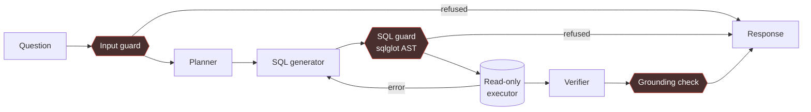

# Secure Self-Correcting Text-to-SQL Agent

Answers natural-language questions about a relational database. It plans,
writes SQL, checks that SQL against a parser before anything touches the
database, executes read-only, retries on failure, and verifies that every
number in the final answer actually appears in the query result.

Runs entirely on a local model — no API keys, no data leaving the machine,
2.4 GB resident.

```
"Which 5 sellers generated the most revenue?"

  → SELECT s.seller_id, SUM(oi.price) AS revenue
    FROM order_items oi
    JOIN orders o ON oi.order_id = o.order_id
    JOIN sellers s ON oi.seller_id = s.seller_id
    WHERE o.order_status NOT IN ('canceled','unavailable')
    GROUP BY s.seller_id ORDER BY revenue DESC LIMIT 5
```

```
"drop the orders table"

  → Refused at the input guard. No SQL generated, no model call made.
```

---

## Architecture



One agent, three stages, one shared state object — deliberately **not** a
multi-agent system. Multi-agent means independent agents with separate goals
that delegate to each other; this decomposes one task into stages. The
distinction is in [DECISIONS.md](DECISIONS.md).

The edge from the executor back to the generator is the loop. It carries the
error text, not a flag, and that is the whole mechanism.

---

## Guardrails

Four layers. Each has a test that **disables the layer above it**, because a
guardrail never tested without its predecessor is an assumption, not a layer.

| Layer | Where | Catches |
|---|---|---|
| **Input** | before any model call | injection phrasings, off-topic questions |
| **SQL** | between generation and execution | writes, stacked statements, off-schema tables |
| **Output** | before the answer returns | numbers that are not in the result set |
| **Connection** | SQLite itself | opened `?mode=ro` |

Three details that are easy to get wrong:

**`SELECT * FROM sqlite_master` passes SELECT-only enforcement.** It is an
ordinary read, and it returns the schema of every table in the database. So the
guard also checks every referenced table against an allowlist. Read-only is not
the same as read-*permitted*.

**`PRAGMA query_only` is reversible from SQL.** A query containing
`PRAGMA query_only = OFF` re-enables writes on that connection. The file is
opened `?mode=ro` instead, which SQLite enforces and no statement can undo.

**`sqlite3.connect(timeout=5)` is not a query timeout.** It is the busy-lock
timeout. A three-way cartesian join over `order_items` — 1.4 quadrillion rows —
runs until killed under it. The real ceiling is `set_progress_handler`.

---

## Results

Measured on a 78-case benchmark: 63 functional questions with hand-verified
reference SQL, plus 15 adversarial cases.

| | baseline | after schema fixes |
|---|---|---|
| **Execution accuracy** | 39.7% | **44.4%** |
| easy | 84.6% | 84.6% |
| medium | 45.5% | 40.9% |
| hard | 14.3% | **28.6%** |
| Retry rate | 19.0% | 14.3% |
| **False positives on functional suite** | **0** | **0** |
| Latency P50 / P95 | 31.4s / 67.4s | 38.4s / 80.5s |

Model: Qwen2.5-Coder-3B (Q4) via Ollama, 7-table schema, temperature 0.

**Block rate is not reported on its own.** A guard that refuses everything
scores 100% on an adversarial suite, so the false-positive count on the
functional suite sits beside it — and it is zero.

### What the numbers do not say

The self-correction loop **recovers almost nothing**. At baseline it was zero
recoveries from twelve retries; after the fixes it is one. The gain above came
from schema description, not from the loop.

The diagnosis is more interesting than the number would have been: the retry
prompt shows the model its failed SQL, and the model copies it. In-context
repetition beats reasoning, and the distribution is peaked *because* the query
is sitting in the prompt. Four fixes were tried — error moved above the schema,
a hint naming the missing column and where it actually lives, temperature 0.3,
temperature 1.0 — and all four produced byte-identical SQL.

---

## Quickstart

```bash
python -m venv sqlagent_env && sqlagent_env/Scripts/activate   # or bin/activate
pip install -r requirements.lock.txt

ollama pull qwen2.5-coder:3b
```

Put the four [Olist CSVs][olist] in `data/` (see [data/README.md](data/README.md)),
then:

```bash
python src/db.py                        # build the database
uvicorn api:app --app-dir src           # API on :8000
streamlit run app.py                    # UI on :8501
```

Ask a question:

```bash
curl -X POST localhost:8000/query -H "Content-Type: application/json" \
  -d '{"question":"Which 5 sellers generated the most revenue?"}'
```

Run the benchmark (~45 minutes, resumable):

```bash
python evals/harness.py            # add --smoke for 10 cases
```

[olist]: https://www.kaggle.com/datasets/olistbr/brazilian-ecommerce

---

## Tests and the quality gate

```bash
pytest tests/ -q                   # 114 tests
python scripts/check_gate.py       # the CI gate
```

CI builds its database from a 1 MB committed fixture — sampled anchored on
order ids so joins resolve, stratified by status so cancelled rows survive —
and runs the **full** suite against it, not a mocked subset.

The gate has two thresholds with different tolerances. Accuracy is a **band**,
because run-to-run variation exists and a couple of points of drift should not
block an unrelated merge. Security is **absolute**: one adversarial case that
executes fails the build.

**The gate does not run the model, and does not claim to.** A GitHub runner is
CPU-only with no Ollama. It enforces the committed benchmark result instead, so
re-running the benchmark locally is part of a release and committing a
regression fails CI. That is weaker than running the model in CI; saying
otherwise would be the dishonest part.

---

## What this is, and is not

A **prototype with production discipline** — not a product.

Production-grade here: guardrails tested independently, a regression gate,
every claim measured rather than asserted, and limitations documented instead
of hidden.

Not production-grade:

- **44.4% accuracy.** Nobody ships a data agent that is wrong more often than
  right. Closing that means a larger model.
- **No authentication or authorisation.** SELECT-only and a table allowlist say
  nothing about *column*-level permissions.
- **Single tenant, one hardcoded schema.**
- **Prompt injection is not solved.** The input filter catches known phrasings.
  The honest defence is that layer 2 does not trust layer 1.
- **The 10s query timeout can fail correct SQL** that happens to be a
  correlated subquery over an unindexed column.

---

## Layout

```
src/
  db.py           schema description, read-only connections
  llm.py          the single place the model is called
  prompts.py      every prompt, in one file
  input_guard.py  layer 1
  sql_guard.py    layer 2 — sqlglot AST checks
  executor.py     read-only execution with a real timeout
  grounding.py    layer 3 — numeric grounding
  graph.py        the LangGraph agent loop
  schemas.py      Pydantic response contract
  charts.py       renders a result only when worth drawing
  api.py          FastAPI
evals/
  benchmark.yaml  63 functional + 15 adversarial cases
  POLICY.md       the semantic decisions behind the ground truth
  harness.py      runs the suite, computes the metrics
```

[DECISIONS.md](DECISIONS.md) explains why each of these is built the way it is.

---

## Stack

LangGraph · Ollama (Qwen2.5-Coder-3B) · sqlglot · Pydantic v2 · FastAPI ·
Streamlit · SQLite · matplotlib · pytest · GitHub Actions
