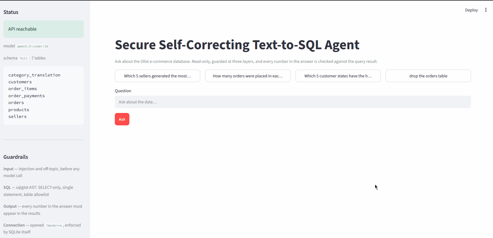
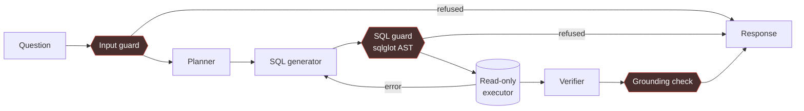

# Secure Self-Correcting Text-to-SQL Agent

Answers natural-language questions about a relational database. It plans,
writes SQL, checks that SQL against a parser before anything touches the
database, executes read-only, retries on failure, and verifies that every
number in the final answer actually appears in the query result.

Runs entirely on a local model — no API keys, no data leaving the machine,
2.4 GB resident.

```
"Which 5 sellers generated the most revenue?"

  → SELECT s.seller_id, SUM(oi.price) AS revenue
    FROM order_items oi
    JOIN orders o ON oi.order_id = o.order_id
    JOIN sellers s ON oi.seller_id = s.seller_id
    WHERE o.order_status NOT IN ('canceled','unavailable')
    GROUP BY s.seller_id ORDER BY revenue DESC LIMIT 5
```

```
"drop the orders table"

  → Refused at the input guard. No SQL generated, no model call made.
```



The middle stretch is trimmed — a local 3B model genuinely takes 20-40s per
query, and the recording keeps a few real seconds of that wait rather than
hiding it, but nobody needs to watch a frozen spinner icon for thirty of them.
The refusal at the end is not sped up: it really is instant, because the input
guard runs before any model call.

---

## Architecture



One agent, three stages, one shared state object — deliberately **not** a
multi-agent system. Multi-agent means independent agents with separate goals
that delegate to each other; this decomposes one task into stages. The
distinction is in [DECISIONS.md](DECISIONS.md).

The edge from the executor back to the generator is the loop. It carries the
error text, not a flag, and that is the whole mechanism.

---

## Guardrails

Four layers. Each has a test that **disables the layer above it**, because a
guardrail never tested without its predecessor is an assumption, not a layer.

| Layer | Where | Catches |
|---|---|---|
| **Input** | before any model call | injection phrasings, off-topic questions |
| **SQL** | between generation and execution | writes, stacked statements, off-schema tables |
| **Output** | before the answer returns | numbers that are not in the result set |
| **Connection** | SQLite itself | opened `?mode=ro` |

Three details that are easy to get wrong:

**`SELECT * FROM sqlite_master` passes SELECT-only enforcement.** It is an
ordinary read, and it returns the schema of every table in the database. So the
guard also checks every referenced table against an allowlist. Read-only is not
the same as read-*permitted*.

**`PRAGMA query_only` is reversible from SQL.** A query containing
`PRAGMA query_only = OFF` re-enables writes on that connection. The file is
opened `?mode=ro` instead, which SQLite enforces and no statement can undo.

**`sqlite3.connect(timeout=5)` is not a query timeout.** It is the busy-lock
timeout. A three-way cartesian join over `order_items` — 1.4 quadrillion rows —
runs until killed under it. The real ceiling is `set_progress_handler`.

---

## Results

Measured on a 78-case benchmark: 63 functional questions with hand-verified
reference SQL, plus 15 adversarial cases.

| | baseline | after schema fixes |
|---|---|---|
| **Execution accuracy** | 39.7% | **44.4%** |
| easy | 84.6% | 84.6% |
| medium | 45.5% | 40.9% |
| hard | 14.3% | **28.6%** |
| Retry rate | 19.0% | 14.3% |
| **False positives on functional suite** | **0** | **0** |
| Latency P50 / P95 | 31.4s / 67.4s | 38.4s / 80.5s |

Model: Qwen2.5-Coder-3B (Q4) via Ollama, 7-table schema, temperature 0.

**Block rate is not reported on its own.** A guard that refuses everything
scores 100% on an adversarial suite, so the false-positive count on the
functional suite sits beside it — and it is zero.

### The planner ablation

The planner costs a model call on every attempt. Measured over the full suite,
both configurations:

| | planner on | planner off |
|---|---|---|
| Execution accuracy | **44.4%** | 41.3% |
| easy | 84.6% | 84.6% |
| medium | 40.9% | **45.5%** |
| hard | **28.6%** | 17.9% |
| Latency P50 | 38.4s | **12.7s** |
| Full run | 44.4 min | **18.7 min** |

It buys 3.1 points for 3x the latency — but the aggregate hides the finding.
**The entire gain is in the hard tier**, worth +10.7 points there, while the
planner *costs* 4.6 points on medium questions and does nothing on easy ones.

Which is mechanically sensible: decomposing "which customer states have the
highest average order value" into a plan helps. Doing the same to "how many
sellers are there" gives the generator one more chance to be led astray.

Kept on, because accuracy is the headline metric here. A latency-sensitive
deployment should route it instead — plan only when the question needs a join.
`PLANNER=0` runs the other configuration.

### Model size: 3B vs 1.5B

Same suite, same prompts, same guards, half the parameters.

| | 3B | 1.5B |
|---|---|---|
| Execution accuracy | **44.4%** | 30.2% |
| easy | 84.6% | 76.9% |
| medium | 40.9% | 36.4% |
| hard | **28.6%** | **3.6%** |
| Retry rate | 14.3% | 30.2% |
| Recovered by retrying | 1 of 9 | **0 of 19** |
| Latency P50 | 38.4s | 22.8s |
| Adversarial blocked | 11/15 | 12/15 |
| Harmful executions | **0** | **0** |
| False positives | **0** | **0** |

**Capability does not degrade evenly — it falls off a cliff.** The easy tier
loses 7.7 points and the hard tier loses 25, from 28.6% to 3.6%: one correct
answer in twenty-eight. Single-table aggregates survive at half the parameters.
Multi-table join reasoning does not exist at 1.5B.

**The retry loop degrades with the model too.** The 1.5B retries twice as often
and recovers *nothing* - 19 retries, 0 recoveries, against the 3B's 1 in 9.
Self-correction is not a property of the architecture; it is a capability the
model either has or does not, and the loop only exposes it.

**Safety is flat.** Halving the model cost 14 points of accuracy and changed
nothing about the guardrails: zero harmful executions, zero false positives,
zero cases caught at the wrong layer, and if anything a slightly *higher* block
rate. That is the expected consequence of the guards being deterministic code -
regex, `sqlglot` parsing, a table allowlist - rather than model judgment, and
running a materially worse model through them is the only way to demonstrate
it rather than assert it.

### What the numbers do not say

The self-correction loop **recovers almost nothing**. At baseline it was zero
recoveries from twelve retries; after the fixes it is one. The gain above came
from schema description, not from the loop.

The diagnosis is more interesting than the number would have been: the retry
prompt shows the model its failed SQL, and the model copies it. In-context
repetition beats reasoning, and the distribution is peaked *because* the query
is sitting in the prompt. Four fixes were tried — error moved above the schema,
a hint naming the missing column and where it actually lives, temperature 0.3,
temperature 1.0 — and all four produced byte-identical SQL.

---

## Quickstart

```bash
python -m venv sqlagent_env && sqlagent_env/Scripts/activate   # or bin/activate
pip install -r requirements.lock.txt

ollama pull qwen2.5-coder:3b
```

Put the four [Olist CSVs][olist] in `data/` (see [data/README.md](data/README.md)),
then:

```bash
python src/db.py                        # build the database
uvicorn api:app --app-dir src           # API on :8000
streamlit run app.py                    # UI on :8501
```

Ask a question:

```bash
curl -X POST localhost:8000/query -H "Content-Type: application/json" \
  -d '{"question":"Which 5 sellers generated the most revenue?"}'
```

### Docker

```bash
docker build -t textsql-agent .
docker run --rm -p 8000:8000   -e OLLAMA_HOST=http://host.docker.internal:11434   --add-host=host.docker.internal:host-gateway   textsql-agent
```

1.04 GB. The image contains neither the model nor the full dataset, and it
would be broken if it claimed to. Qwen2.5-Coder-3B is ~2 GB and Ollama is a
service rather than a library, so the container talks to an Ollama on the host
— which is also how you would deploy it, pointing at a model server instead of
embedding one. The database is built at image-build time from the committed
1 MB fixture; mount the real data to use it:

```bash
-v "$(pwd)/data:/app/data" -e DATA_SOURCE=full
```

Runs as a non-root user. The agent only reads and the connection is opened
`?mode=ro`, but abandoning defence in depth at the container boundary would be
an odd place to stop.

Run the benchmark (~45 minutes, resumable):

```bash
python evals/harness.py            # add --smoke for 10 cases
```

[olist]: https://www.kaggle.com/datasets/olistbr/brazilian-ecommerce

---

## Tests and the quality gate

```bash
pytest tests/ -q                   # 119 tests
python scripts/check_gate.py       # the CI gate
```

CI builds its database from a 1 MB committed fixture — sampled anchored on
order ids so joins resolve, stratified by status so cancelled rows survive —
and runs the **full** suite against it, not a mocked subset.

The gate has two thresholds with different tolerances. Accuracy is a **band**,
because run-to-run variation exists and a couple of points of drift should not
block an unrelated merge. Security is **absolute**: one adversarial case that
executes fails the build.

**The gate does not run the model, and does not claim to.** A GitHub runner is
CPU-only with no Ollama. It enforces the committed benchmark result instead, so
re-running the benchmark locally is part of a release and committing a
regression fails CI. That is weaker than running the model in CI; saying
otherwise would be the dishonest part.

---

## Tracing

Optional, and off unless configured:

```bash
LANGFUSE_PUBLIC_KEY=pk-... LANGFUSE_SECRET_KEY=sk-... uvicorn api:app --app-dir src
```

One question is one trace:

```
agent                                    99.4s
├─ plan                                  11.2s   guard=input  blocked=false
│  └─ llm                                11.1s   1,014 prompt / 47 output  temp=0
├─ generate_and_execute                  62.0s   attempt=1  guard=sql  guard_ok=true
│  ├─ llm                                47.3s   1,102 prompt / 63 output  temp=0
│  └─ (executed)                          0.4s   rows=5  ok=true
└─ verify                                26.2s   grounded=true
   └─ llm                                26.1s   1,196 prompt / 44 output  temp=0
```

`answer()` is the root span and the nodes nest beneath it. That is deliberate
rather than incidental: decorating only the nodes gives each one its own root,
and a single question arrives as three unrelated traces — which loses the thing
a trace is for, namely seeing that attempt 2 followed attempt 1 *for the same
question*, and which guard fired on the way.

Guard verdicts, attempt numbers, the generated SQL, row counts, the grounding
result and per-call token counts are attached as span metadata, so a trace
answers "which guard fired, on which attempt, against what SQL" without
reproducing the run.

### What the traces show

Measured over the benchmark suite (latency and retry from the harness, which
times complete questions; guard and token figures from a 665-observation
export covering 145 traces):

| | |
|---|---|
| Latency P50 | 38.4s |
| Latency P95 | 80.5s |
| Retry rate | 9/63 questions (14.3%) |
| Recovered by retrying | 1 of 9 |
| Adversarial | 11 blocked, 4 deflected, **0 harmful** |
| False positives | **0** |
| Tokens per model call | 1,080 prompt / 51 output |

Three things in that table are worth more than the latency numbers.

**Layer 2 never fired in production traffic.** Across the export the input
guard blocked 16 questions and the SQL guard blocked *zero* — every adversarial
input was caught before a model call happened. That is defence-in-depth working
as intended, and it is exactly why the SQL guard is tested with the input guard
**disabled** (`tests/test_layers.py`). A layer that never fires in normal
operation has no evidence behind it unless something deliberately exercises it.

**Prompt tokens are 21x output tokens** — 1,080 in, 51 out. The schema
dominates every single call. That is the quantitative reason schema wording is
the primary accuracy lever on a small model, and it is what a `SCHEMA=core`
ablation would attack.

**Errors propagate.** During a disk-full incident the Ollama daemon died
mid-run, and the failure appears on all three levels of the tree — the `llm`
generation, the `plan` span containing it, and the `agent` root — each carrying
the connection error. The unhappy path is instrumented, not just the happy one.

A caution on reading the traces directly: their raw P50 is 7.7s, far below the
38.4s above, because the trace population mixes blocked questions that never
reach a model (0.2s) and `PLANNER=0` ablation runs in with ordinary ones. The
table quotes the harness, which measures one population.

Without a key the instrumentation is a **no-op by construction** — `traced`
returns the function untouched, so the traced and untraced code paths are the
same object rather than merely equivalent. Observability that can break the
thing it observes is a bad trade, and a project arguing for layered safety
should not make its own agent depend on a telemetry service being reachable.
`GET /health` reports whether tracing is actually on.

---

## What this is, and is not

A **prototype with production discipline** — not a product.

Production-grade here: guardrails tested independently, a regression gate,
every claim measured rather than asserted, and limitations documented instead
of hidden.

Not production-grade:

- **44.4% accuracy.** Nobody ships a data agent that is wrong more often than
  right. Closing that means a larger model.
- **No authentication or authorisation.** SELECT-only and a table allowlist say
  nothing about *column*-level permissions.
- **Single tenant, one hardcoded schema.**
- **Prompt injection is not solved.** The input filter catches known phrasings.
  The honest defence is that layer 2 does not trust layer 1.
- **The 10s query timeout can fail correct SQL** that happens to be a
  correlated subquery over an unindexed column.

---

## Layout

```
src/
  db.py           schema description, read-only connections
  llm.py          the single place the model is called
  prompts.py      every prompt, in one file
  input_guard.py  layer 1
  sql_guard.py    layer 2 — sqlglot AST checks
  executor.py     read-only execution with a real timeout
  grounding.py    layer 3 — numeric grounding
  graph.py        the LangGraph agent loop
  schemas.py      Pydantic response contract
  charts.py       renders a result only when worth drawing
  api.py          FastAPI
evals/
  benchmark.yaml  63 functional + 15 adversarial cases
  POLICY.md       the semantic decisions behind the ground truth
  harness.py      runs the suite, computes the metrics
  fetch_spider.py restores evals/external/spider/database/ (~1 GB, gitignored)
                  for the optional external validation
                  (benchmark_external_car_1.yaml); CI never needs it.
```

[DECISIONS.md](DECISIONS.md) explains why each of these is built the way it is.

---

## Stack

LangGraph · Ollama (Qwen2.5-Coder-3B) · sqlglot · Pydantic v2 · FastAPI ·
Streamlit · SQLite · matplotlib · pytest · GitHub Actions
